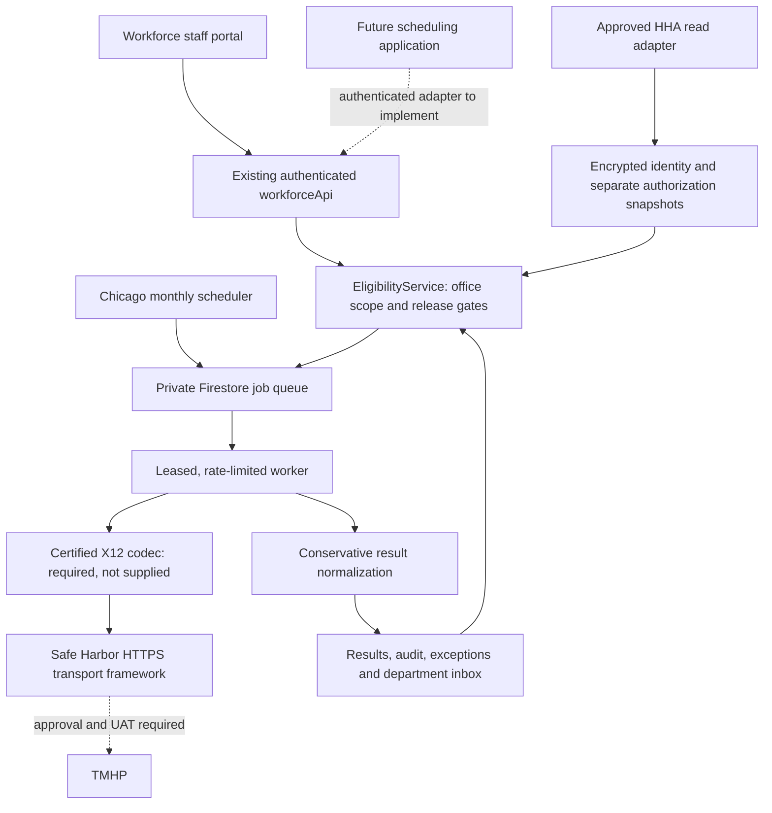

# Medicaid eligibility service — development implementation

Reviewed November 15, 2026, America/Chicago. PTHHS reports that its TMHP EDI approval status is **unknown**.

**This branch is not ready for live eligibility operation.** It implements the Workforce dashboard, private data model, durable job processing, conservative evidence normalization, Safe Harbor transport framework and review workflow. It does not include a licensed, TMHP-certified X12 codec, a production credential binding, or a successful TMHP connection. Runtime dispatch remains blocked by `CERTIFIED_CODEC_AVAILABLE = false` and the unconfigured connector. Changing environment parameters alone cannot activate it.

The research and enrollment checklist are in [RESEARCH.html](RESEARCH.html). The release gates and outstanding engineering work are in [DEPLOYMENT.md](DEPLOYMENT.md). No production deployment, TMHP request, HHA patient read, live member write, agreement acceptance or enrollment submission was performed during development.

## Existing platform audit

Audited repository `jnwokorie1957/pthhs`, initial baseline `f5c03348d9fad973974af53d3ccc401331f776cc`, updated to `0312e82f1d5f1b3be705cf5c2dfc0db171a359ea` before review to preserve concurrent matching changes. The portal uses static HTML and vanilla JavaScript, Firebase Hosting, Firebase Authentication SDK 8.10.1 and backend Cloud Functions. TypeScript ESM functions target Node 22; firebase-admin 14.4.0 and firebase-functions 7.3.2 were already installed in the lockfile. Authored Workforce assets are compiled/minified and content hashed by the existing build scripts. No new frontend framework or dependency was introduced.

`/workforce` is `public/primetime/workforce.html`. Existing `/primetime/workforce-api/**` rewrites go to `workforceApi` in `us-central1`. Server identity validation checks revoked Firebase tokens, disabled accounts, and verified email. Eligibility routes additionally require the existing recent-authentication check (15 minutes), completed training and password setup. Grants in `workforceStaff` contain explicit permissions and assigned offices; an owner role does not imply permission.

`ClientDirectory` already reads HHA `SearchPatients` and `GetPatientDemographics`. Its `memberId` is an admission identifier, not a Medicaid identifier. Existing OperationsWorkspace owns HHA read approval, office scope, shared vendor quotas and read-health records. The existing SOAP adapter and `HHAEXCHANGE_CREDENTIALS` Secret Manager binding are reused. `eligibility_identity` is a server-only projection that adds MedicaidNumber and BirthDate to the existing profile read. It is not an HTTP-selectable projection.

Existing authorization tools track reviewed documents and renewal dates. Existing HHA read operations expose schedules and actual visits. Those systems remain authoritative for their own data; no visit, billing or service authorization mutation is added. Eligibility stores separate HHA authorization date snapshots. Service codes and units are not inferred from date overlap.

Metadata-only inspection found the `(default)` Firestore database in `us-central1`, Standard edition, Native mode. PITR and delete protection were disabled at inspection. No patient collections were queried. Existing client Firestore rules deny all access; those rules remain unchanged. Existing KMS-backed AES-256-GCM envelope encryption is reused for Medicaid identity material. Project-wide BAA status, IAM, audit sink configuration, auth product coverage and Hosting PHI processing have not been validated.

## Backend boundaries

`domain.ts` has no frontend dependency. It distinguishes coverage, enrollment and authorization; rejects unmatched, conflicting or incomplete eligibility evidence; preserves unknown fields; and preserves the last successful result through failures. `connector.ts` separates the transport from a licensed `EdiCodec`. `store.ts` owns persistence and transactions. `service.ts` owns access, querying and orchestration. `runtime.ts` binds Firebase. `hha.ts` reuses the approved source adapter.

The Safe Harbor framework pins official test/production hosts, refuses redirects, uses a bounded request, times out after 25 seconds, bounds responses to 2 MB and validates envelope correlation. No raw request, response, token or vendor error is logged. Its transport tests use injected fetch; they are not evidence of TMHP compatibility. CORE 4.0 certificate handling, SOAP transport and native SFTP batch submission are not implemented.

Existing management, training and readings controllers now use the same deterministic source/minification pipeline as the other Workforce assets. This preserves the established page/asset transfer budgets without changing those limits. The full frontend suite was rerun after this packaging change.

The normalized `Result` includes `status`, `asOf`, `checkedAt`, `source`, optional coverage dates, optional MCO enrollment array, and a controlled failure code. A codec must prove member matching and scope evidence to the correct program/date/benefit before normalization. CHIP, HTW, other insurance and an AAA rejection must not become a Medicaid status. Multiple periods are not flattened into invented dates. The current source discriminator is `tmhp`; a clearinghouse adapter must deliberately extend that contract and source provenance.

## Private storage and matching

| Collection | Purpose |
|---|---|
| medicaidMembers | Stable office/HHA link, active-client state, latest and last-successful eligibility, department, assignment, separate authorization snapshots and revisions |
| medicaidIdentities | Envelope-encrypted Medicaid ID, surname and optional DOB; ciphertext bound to office/member context; unindexed encrypted field |
| medicaidJobs / medicaidRequestLocks | Durable state, original date, trigger, opaque correlation, idempotency, member-date lock, attempts and lease token |
| medicaidControl | Global transaction-rate reservation |
| medicaidResults | Append-only application history for each job attempt |
| medicaidExceptions / medicaidNotifications | Department review queue and private inbox state |
| medicaidNotes / medicaidAudit | Follow-up notes and access/change receipts; no raw identifiers or vendor payloads |
| medicaidRoster | Resumable source manifest and completion status; patient-ID array excluded from indexing |

Identity matching is exact office + HHA PatientID, with source OfficeID revalidation. Reimporting that link does not create another eligibility member. A changed Medicaid identity increments its version and invalidates cached eligibility; pending jobs recheck that version. **Duplicate Medicaid identities across different HHA PatientIDs/offices are not yet reconciled.** Do not merge by name or AdmissionID. Before onboarding real records, approve and implement a keyed matching index and a staff-reviewed conflict workflow, or validate a unique source roster under an approved reconciliation process. A plain hash of a nine-digit identifier is not an adequate privacy control.

All client SDK reads/writes remain denied. API responses require explicit staff access; the ordinary list returns `Protected`/`Unavailable` for Medicaid ID. Full ID reveal requires `eligibility.identifiers`, recent authentication and a private audit event. History UI shows at most 50 results and 50 notes; retained history is not deleted at this limit. App-level append-only behavior is not a substitute for IAM-controlled, retention-protected audit storage.

## Internal API, version 1 contract

Base: existing `/primetime/workforce-api`. Every endpoint below is POST with JSON, Firebase bearer authentication, same-origin protections, recent login and office-scoped explicit grants. JSON bodies are limited to 8 KB. Raw Medicaid identifiers, names and credentials do not belong in paths, query strings or client logs. Responses carry the existing `Cache-Control: no-store` protection.

| Endpoint under `/staff/eligibility` | Permission | Input and behavior |
|---|---|---|
| `/query` | eligibility.read | `{office, filters?, after?}`. Filters: department, mco, status, verifiedAfter/Before (Chicago dates), assignee, reviewOnly, changedOnly. 50 records/page; summary scans up to 10,000 synchronized records and reports completeness. Includes discrepancy flags and connection readiness. |
| `/sync` | eligibility.verify | `{office, patientId}`. Approved HHA source read and private eligibility snapshot only; no source write. Closed until data/HHA approvals. |
| `/{memberKey}/verify` | eligibility.verify | `{idempotencyKey}`; 8–100 alphanumeric/underscore/hyphen characters. Returns `{jobId,state}`. Queues today's Chicago inquiry; never synchronous vendor work in browser. |
| `/{memberKey}/history` | eligibility.read | `{}`. Most recent 50 results and follow-up entries each. |
| `/{memberKey}/review` | eligibility.review | `{revision,action,note,department,assignee}`. action is in_progress/resolved; note max 2,000 characters; optimistic revision and active assignee grant validation. |
| `/{memberKey}/identifier` | eligibility.identifiers | `{}`. Audited, separately authorized full Medicaid-ID reveal; no persistence in browser storage. |

`memberKey` is a 64-character opaque application reference. Common failures: 400 invalid input, 403 access denied, 404 not found, 409 revision conflict/inactive source member, 423 release or connection pending, 429 manual request cooldown, 503 unavailable dependency. Never interpret an HTTP error as Medicaid Inactive. Worker errors become `unable_to_verify` with a controlled reason and review entry.

`enqueueLifecycle(store, release, member, trigger, eventId, serviceDate)` is the reusable backend admission/pre-service interface. Event IDs are hashed for deterministic dedupe. New active members observed by an approved source sync invoke the admission hook; the first complete roster therefore also queues eligible admission checks when connectivity is enabled. Real-time onboarding and scheduled-service event wiring still require the owning workflow adapter. Future apps must use authenticated service adapters, not import Firebase admin credentials into clients.

## Scheduling, queue and exceptions

Monthly fanout is `0 6 1,15 * *` in America/Chicago. It pages 100 source members at a time and uses the original scheduler event date on redelivery. The worker wakes each minute, claims up to 20 due candidates, works within a 45-second budget, and reserves a global minimum interval. Configured requests/minute defaults to zero; the built-in ceiling of 60 is an application limit, **not** a TMHP allowance. Only the written approved vendor limit may be configured.

Jobs are transactionally leased for 120 seconds. At most one outstanding member/date job exists across triggers. Manual requests have a 60-second cooldown after the previous request. Retries use jitter and capped backoff, at most four attempts for explicitly known pre-submission network failure. A timeout or lost response may already have reached TMHP, so it becomes unknown delivery for review rather than blind resubmission. Expired worker leases follow the same rule. The worker rechecks active source status, source freshness (48 hours), identity version, office approval and manual-request staff access before sending.

The source refresh reads at most five profiles per office/tick using existing HHA quota enforcement. Manifests resume after failure and refresh daily after completion. Partial discovery is rejected. Unseen/deleted source records are not automatically deactivated; full roster reconciliation remains a release prerequisite. The dashboard labels incomplete counts. At 2,000 clients, initial profile traversal needs at least 400 ticks per office plus source latency and quota waits; measure this in an approved environment.

Active-to-Inactive creates a private department notification, pending exception, result history and audit entry. A later failure retains the last successful verification. The dashboard filters by department, MCO, coverage status, Chicago verification date, assigned employee and review/change state. Named employee choices include only active, verified office reviewers (at most 200 office grants); follow-up assignments revalidate grant scope. Proactive notification delivery/acknowledgment escalation remains open work. Follow-up never cancels visits, terminates care or edits billing.

## Validation and future platform

On Windows with Node **22.23.5**, backend suite: **1,060 passed, zero failed**; frontend script suite: **698 passed, zero failed**. Strict TypeScript check, generated Workforce runtime/hash checks and `git diff --check` passed. New tests cover active/inactive/unknown evidence, missing/invalid identifiers, invalid dates, expired credentials, failed networks, matching, duplicate requests, lease ownership, unknown delivery, status changes, scope/role denial, encrypted identity versioning, 2,000-member fanout, Chicago scheduling, stale UI results, ID reveal, and manual retry dedupe. The local browser preview used synthetic records and injected responses only; filtering and follow-up submission were exercised. There was no TMHP UAT, live HHA verification or real patient testing.

The Firestore tests use a serializing transaction double with read-before-write checks and rollback. They do not establish real Firestore concurrency, indexes, IAM, emulator integration, queue throughput or provider acceptance. The complete Linux marketing/site regeneration pipeline is delegated to the existing PR quality workflow. Record its final result before merge. Existing dependency audit reported five backend findings (one low, four moderate); no new dependency was added. Re-run security scans before release.

For the independent scheduling platform, extract domain/connector/service contracts into a versioned backend package, move Firebase bindings to an adapter, and add an authenticated service-to-service API with explicit tenant/provider/office authorization. Establish a canonical member-link registry, signed scheduling/admission events, approved retention and transactional event/outbox delivery. Add schedule and actual-visit readers using existing approved HHA operations, then reconcile date, payer, service code and units against separate authorization facts. Preserve staff review as the final operational decision. Version changes must preserve audit/provenance and prevent cross-provider identifier matching. No future-platform tenant or external API has been provisioned.
